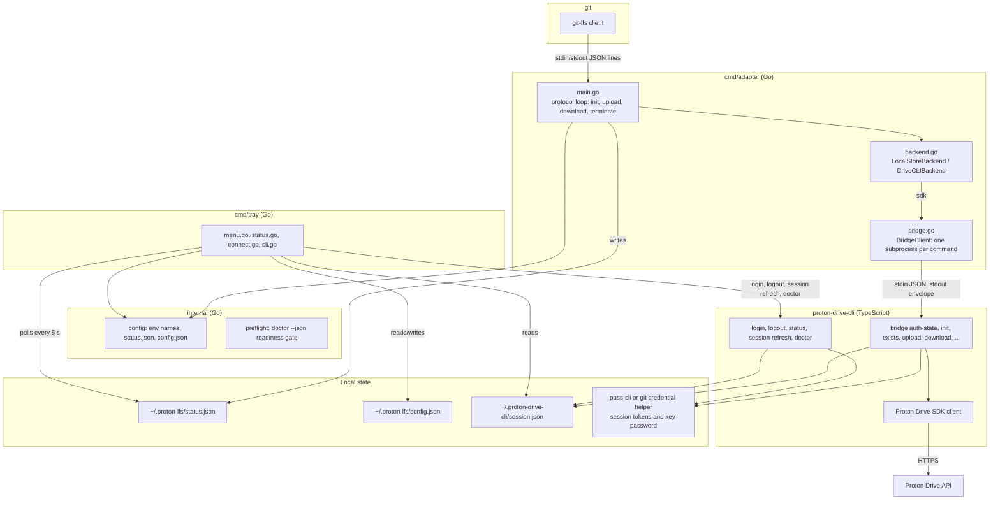
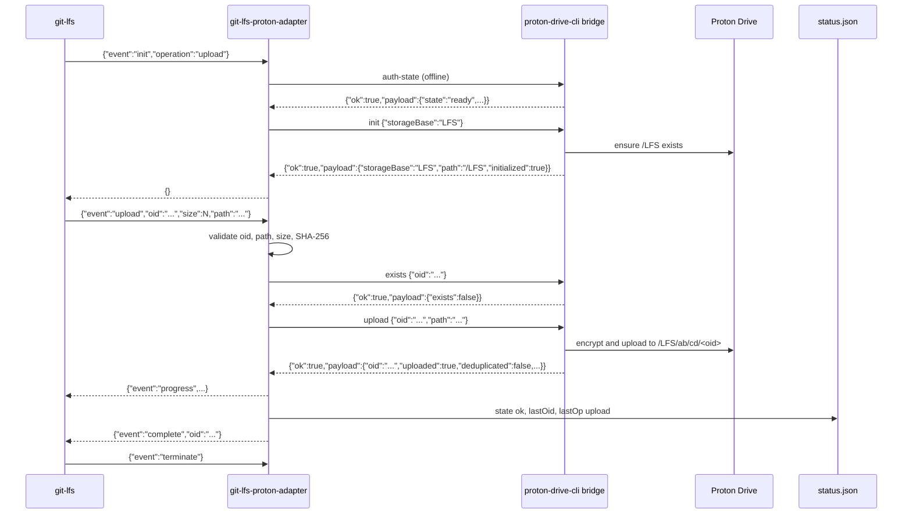
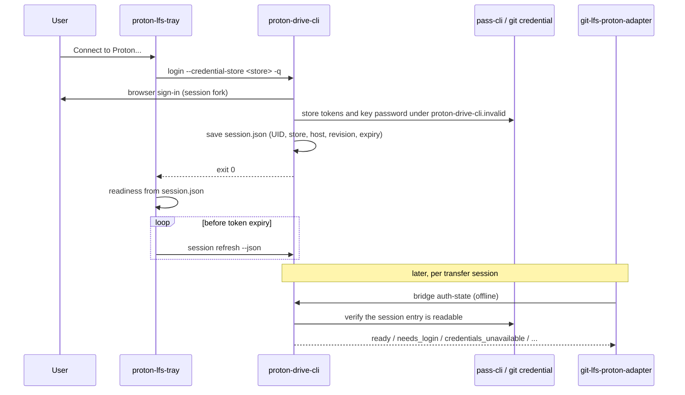
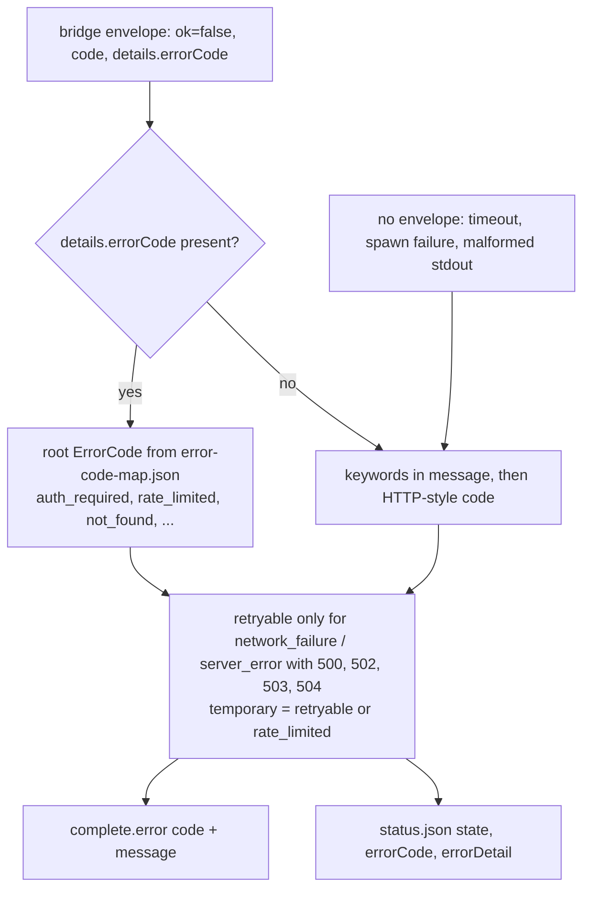
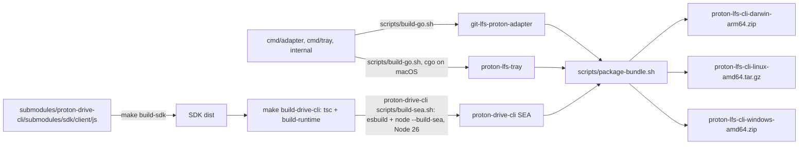

# Proton LFS Architecture

Proton LFS stores Git LFS objects end-to-end encrypted in Proton Drive. Three
programs cooperate: the Go adapter that speaks the Git LFS custom transfer
protocol, the Go system tray that shows status and drives sign-in, and
`proton-drive-cli` (TypeScript, `submodules/proton-drive-cli`) that owns the
Proton session, the cryptography and the Drive API through the official SDK.
Everything on this page is derived from the code it names; the reference
pages under `docs/reference/` hold the exhaustive tables.

## System



Design rules that the code enforces:

- Account login happens only in `proton-drive-cli login` (browser session
  fork), which delivers the key password for every account type; it stores
  the session tokens and the key password in the credential store and writes
  no secret to `session.json`. Transfer commands never carry credentials;
  the adapter's bridge requests contain only `storageBase`, `appVersion` and
  the object fields.
- The adapter fails closed: `init` runs `bridge auth-state` and refuses every
  state other than `ready` and `session_expired`; `bridge init` refreshes an
  expired access token before use.
- git-lfs provides the concurrency: it starts one adapter process per
  transfer slot (`lfs.concurrenttransfers`), and each adapter process handles
  one object at a time with one bridge subprocess per command. There is no
  pool or semaphore in the adapter.
- Every bridge command has a wall-clock budget: `--bridge-timeout` (default
  5 minutes) plus one second per 256 KiB for uploads and downloads; the
  subprocess runs in its own process group and is killed with it.

## Transfer flow



Downloads mirror this: the adapter creates a temporary file, sends it as
`outputPath`, verifies SHA-256 and size of the result, sets mode `0600` and
returns the path to git-lfs. A failed object is answered with
`complete` plus an `error` and the process continues with the next object.
The codes are listed in [Adapter Errors](../reference/adapter-errors.md).

## Sign-in and readiness



The tray derives `Status`, `Session`, `Transfers` and `Refresh` lines from
the session file and the refresh state (rules in
[Tray Reference](../reference/tray.md)); `auth-state` is the adapter's gate.
Both are local checks: a session Proton revoked server-side is discovered by
the first SDK call and reported as an auth failure, never retried with a
login.

## Local state

```text
~/.proton-lfs/
├── status.json          # adapter -> tray (0600, atomic)
├── config.json          # tray preferences (0600, atomic)
├── tray.log             # tray log (0600, append)
└── tray.lock            # single-instance lock

~/.proton-drive-cli/     # 0700
├── session.json         # uid, scopes, credential store and host, revision, expiry; no secret (0600)
├── session.lock         # proper-lockfile directory guarding refresh-token rotation
├── crypto-cache.json    # cached user and address records of the session UID (0600, 1 h)
├── rate-limit-cooldown.json  # wait-until timestamp after a Proton rate limit (0600)
└── client-uid.json      # client UID sent with upload drafts (0600; client-uid.lock guards its creation)
```

Objects in Proton Drive live at `/<storageBase>/<oid[0:2]>/<oid[2:4]>/<oid>`
with `storageBase` defaulting to `LFS` (`oidToPath` in
`src/bridge/validators.ts`). The local backend uses the same layout under
`--local-store-dir`. Temporary download files are `git-lfs-proton-download-*`
in the system temp directory; files matching `git-lfs-proton-*` older than
10 minutes are removed when an adapter starts.

## Status reporting

The adapter writes `~/.proton-lfs/status.json` on every completed or failed
transfer, never on `init` or `terminate`; the tray polls it every 5 seconds.
The six states are `ok`, `transferring` (declared and rendered, never
written by the adapter), `error`, `rate_limited`, `auth_required` and
`captcha`; the tray maps them onto four icons (idle, ok, error, syncing),
`rate_limited`, `auth_required` and `captcha` sharing the error icon. Field
and code vocabularies: [Status File Reference](../reference/status-file.md).

## Error classification



The bridge retries a failing upload or download three times with 1-5 s
backoff before it reports; the adapter does not retry.

## Build and distribution



Bundle layouts produced by `scripts/package-bundle.sh`:

```text
proton-lfs-cli-darwin-arm64/ProtonLFS.app/Contents/
├── MacOS/proton-lfs-tray
├── Helpers/git-lfs-proton-adapter
├── Helpers/proton-drive-cli
├── Resources/AppIcon.icns
└── Info.plist                      # CFBundleIdentifier com.proton.lfs-tray, ad-hoc signed

proton-lfs-cli-linux-amd64/
├── proton-lfs-tray
├── git-lfs-proton-adapter
├── proton-drive-cli
└── proton-lfs.desktop              # for ~/.config/autostart or ~/.local/share/applications

proton-lfs-cli-windows-amd64/
├── proton-lfs-tray.exe
├── git-lfs-proton-adapter.exe
└── proton-drive-cli.exe
```

`release-bundle.yml` runs on `v*` tags: `adapters` (standalone adapter for
linux amd64/arm64, darwin amd64/arm64, windows amd64 via `build.yml`),
`build-all` (macos-15 darwin-arm64, ubuntu-latest linux-amd64,
windows-latest windows-amd64), `package`, and `release` (one GitHub Release
with every asset, `SHA256SUMS.txt` over all of them and a git-cliff
changelog). Archives are reproducible (`SOURCE_DATE_EPOCH` = commit date,
sorted entries, numeric owner 0:0). Details: [Releasing](../operations/releasing.md).

## Logging

- Adapter: errors always go to stderr, which git-lfs records under
  `GIT_TRACE=1`; `--debug` adds per-message diagnostics.
- Tray: `~/.proton-lfs/tray.log` and stderr, with tokens redacted.
- proton-drive-cli: stderr; the bridge logs at ERROR level unless
  `DEBUG=true` is set in its environment (the adapter does not forward
  `DEBUG`).

## Testing

| Command | Covers |
| --- | --- |
| `make test` | Go unit tests for `./cmd/...` and `./internal/...` |
| `make test-integration` | Git LFS protocol with the local backend through real `git-lfs` |
| `make test-integration-adapter-exit` | Adapter exits mid-transfer without a `complete` message |
| `make test-integration-failure-modes` | Wrong OID, crash, exit without response |
| `make test-integration-config-matrix` | Upload-only / download-only direction gating |
| `make test-integration-credentials` | No secrets reach the bridge; session file permissions |
| `make test-e2e-mock` | Full push/pull through the mocked proton-drive-cli |
| `make test-integration-sdk` | sdk backend against a built proton-drive-cli (needs a session and pass-cli) |
| `make test-e2e-real` | Guarded real Proton transfer (see the live canary runbook) |

See [Integration Testing](../testing/integration-testing.md).

## Known limitations

- The sdk backend reports progress once per object after the bridge command
  returns; the local backend streams progress in 64 KiB steps.
- Interrupted transfers are not resumed; git-lfs retries the object.
- CAPTCHA and two-factor challenges are completed in the browser during
  `proton-drive-cli login`; transfers stop with `captcha` or
  `auth_required`.
- Rate limiting stops the transfer (`rate_limited`); the user retries later.

## References

- [Git LFS custom transfer specification](https://github.com/git-lfs/git-lfs/blob/main/docs/custom-transfers.md)
- [Subprocess Integration](subprocess-integration.md)
- [Proton SDK Bridge](proton-sdk-bridge.md)
- proton-drive-cli bridge protocol: `submodules/proton-drive-cli/docs/reference/bridge-protocol.md` ([documentation site](https://sevenofnine-labs.github.io/proton-drive-cli/))
